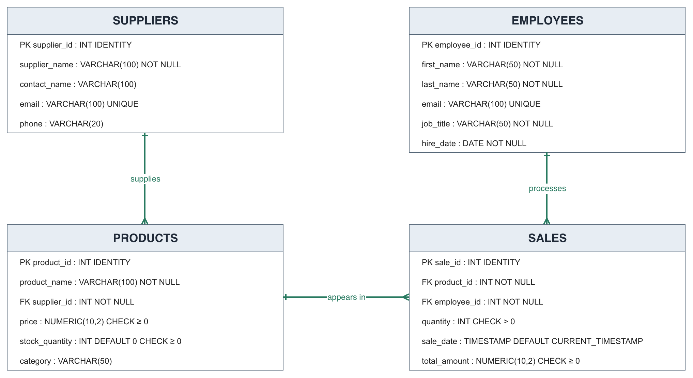

# PostgreSQL Role-Based Access Control for a Retail Store Inventory Management System 

This project is a PostgreSQL database for an inventory system at a retail store, and it tracks suppliers, products, sales, and employees. 



Access to the database is controlled with role-based access controls (RBAC), with users being assigned as a Manager, Employee, or Viewer. For more details on the permissions of each role, view the [permission matrix document](docs/security/permission_matrix.md).

## Repository Structure
| Folder | Contents |
|---|---|
| `sql/schema/` | Table definitions and sample data |
| `sql/roles/` | Roles, permissions, and users |
| `sql/tests/` | RBAC permission tests |
| `scripts/` | Setup and test scripts |
| `docs/` | ERD, permission matrix and test results |

## Setup
The software requirements for running the database are:
- PostgreSQL (tested on v18.3)
- Bash

To set up the database, you must run 
```bash
./scripts/setup.sh
```
The script will then:
- Create the `retail_db` database
- Create the tables (`sql/schema/01_create_tables.sql`)
- Insert sample data (`sql/schema/02_insert_data.sql`)
- Create roles and grant permissions ('sql/roles/03_create_roles.sql`)
- Create the login users and assign their roles (`sql/roles/04_create_users.sql`)
- Print a summary of users and table contents

If `retail_db` already exists, the script will ask:
```
Database retail_db already exists. Reset it? [y/N]
```
- **y**: drops the database (`sql/99_teardown.sql`), and rebuilds everything 
- **N** or Enter: exits without changes

## Running tests
